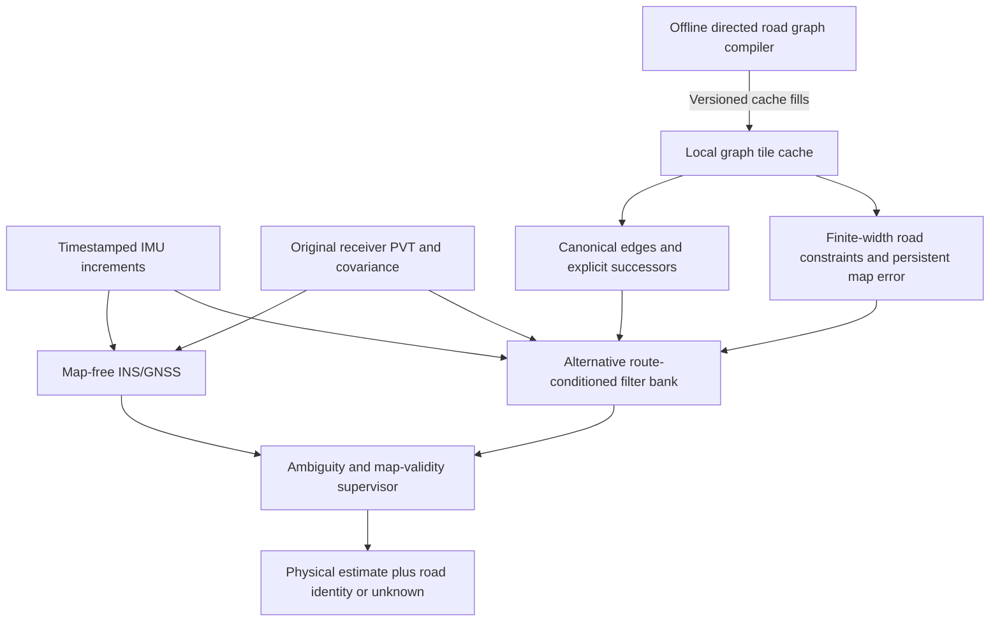

# Navigation research

Research on **tiled-road-aided, loosely coupled INS/GNSS navigation** for low-bandwidth devices using receiver PVT and a consumer IMU. RouteFusion maintains alternative road-conditioned navigation filters, finite-width road corridors, persistent error states, and an independent map-free fallback.

The repository contains the original **planar Python research prototype** and a separate **native 3-D `imu_gnss_fusion` integration**. Neither is field-qualified u-blox M9 / LSM6DSO firmware. Road identity and physical coordinate accuracy are separate outputs, and failure/abstention cases remain visible.

## Native integration and recorded-data evaluation

The [native integration](integration/imu_gnss/README.md) runs the actual pinned Rust `SensorFusion` implementation, including its 18-error-state filter, mounting alignment, GNSS/NHC processing, gating and health policies. The upstream repository is unchanged; minimal research hooks are applied only to an isolated build.

The [evaluation report](integration/imu_gnss/REPORT.md) covers 35 accepted dataset replays (about 10 hours), one rejected duplicate-timestamp stream, four independent-OSM map experiments, and two labelled input-stress tests. The [evidence](integration/imu_gnss/evidence) includes per-recording metrics, compressed epoch traces, audits, native test logs and hashes. The [map cache](integration/imu_gnss/map_cache) retains the exact independently fetched OSM snapshot.

**Reference agreement is not independently established absolute accuracy.** Default output remains map-free/shadow mode. Clean reference-bearing drives show essentially no coordinate gain; an injected outage improves modestly, while an injected persistent position bias barely improves. Initialization delays, conditional branch loss and memory cost are documented rather than hidden.

## Original planar study

| Resource | Contents |
|---|---|
| [Research and design](routefusion_prototype/docs/DESIGN.md) | Literature synthesis, probabilistic model, architecture, uncertainty, and tradeoffs |
| [Integration guide](routefusion_prototype/docs/INTEGRATION.md) | Adapter to an existing full ESKF; timing, frames, covariance, and tile contracts |
| [Original validation report](routefusion_prototype/docs/VALIDATION.md) | Six synthetic scenarios, 60 runs, and known limitations |
| [Executable code](routefusion_prototype/routefusion) | Navigation filter, route-hypothesis bank, tile compiler, replay, and simulator |
| [Source ledger](routefusion_prototype/sources.json) | 15 primary references with access/inspection limits |
| [Published reproduction](routefusion_prototype/results) | 60 CSV traces, six input logs with tiles, six replays, metrics, logs, and figure |
| [Original numerical records](provenance/original-metrics.json) | Exact original per-run metrics, including historical runtimes |
| [Original summary](provenance/original-summary.json) | Exact original scenario aggregates |
| [Combined original report](routefusion_research_and_design.md) | Research, validation, and integration in one document |
| [Prototype ZIP](artifacts/routefusion_prototype.zip) | Original code/documentation plus the separately labelled reproduced results |
| [Provenance](docs/PROVENANCE.md) | Original versus reproduced artifacts, checksums, and reproducibility limits |

## Architecture



Branch outputs are alternatives, not independent sensors to feed back into one another. Full raw satellite measurements and a continuous network correction stream are not required by this design.

## Reproduce the original study

From the repository root, with Python 3.13 for the captured dependency versions:

```sh
python -m venv .venv
. .venv/bin/activate
python -m pip install -r requirements-reproduce.txt -e ./routefusion_prototype
python scripts/verify_snapshot.py
python scripts/reproduce.py --output runs/my-evaluation
```

For native recorded-data evaluation, use the separate [native reproduction instructions](integration/imu_gnss/README.md#reproduce), including the pinned Rust toolchain and source checkout.

On Windows PowerShell, activate with `.venv\Scripts\Activate.ps1`. The original reproduction command sets numerical-library threading, refuses to overwrite existing runs, and writes fresh evidence to the requested directory. It runs the 24 original algorithm tests plus six publication-tool checks, evaluates 60 scenario/seed combinations, compares navigation metrics with the original records, and checks six example replays (720 outputs).

The original package README remains historical documentation. Prefer these safe commands over its old command that writes directly into `results/`.

## Original results and evidence boundary


The original study used seeds 100–109, six scenarios, 120 seconds per run, and 7,200 map epochs. It was not an M9/LSM6DSO field trial, an UrbanNav evaluation, or a benchmark of the native implementation. The later native integration has its own report and provenance.

Original code, report, per-run metrics, summary, environment record, and test log are preserved with checksum verification. The original project's published traces, tile examples, figure, logs and ZIP were produced in a **fresh reproduction**, not presented as byte-identical copies of its first ZIP. Numerical comparisons use 1e-9 absolute/relative tolerance. Fresh runtimes never replace historical values.

The naive nearest-road diagnostic can break exact parallel-road ties differently across CPUs. Differences are recorded, not hidden: qualification requires all 120 relevant fixes to remain on the equal-distance bisector, equal route weights, and ambiguous output. Other non-timing comparisons remain strict. See [provenance](docs/PROVENANCE.md) and [publication record](provenance/IMPORT_VERIFICATION.json).

A shifted map worsened position RMSE despite correct road identification. Symmetric parallel roads remained unresolved. An old latch persisted for three seconds after leaving a mapped road in the synthetic case. Conditional weights are not calibrated integrity probabilities.

New work stays separate from the preserved reference. Raw upstream recordings and third-party papers are not duplicated here. The native integration separately retains an attributed OpenStreetMap extract under ODbL 1.0 and derived replay results. This research import does not assign a new project code license.
