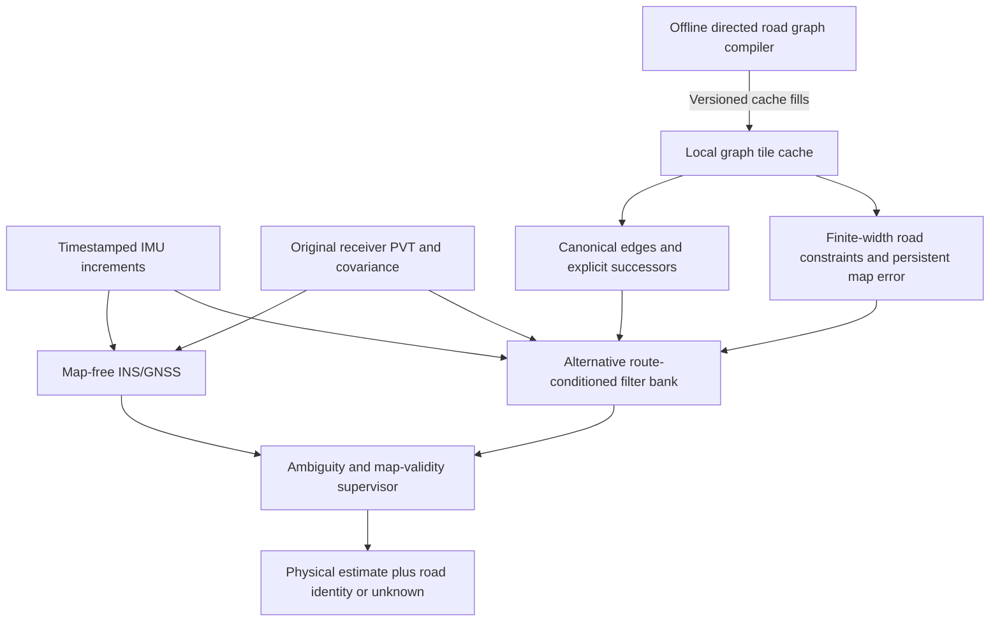
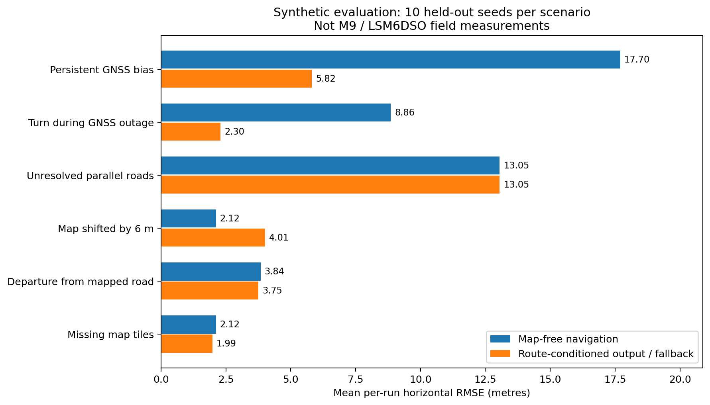

# Navigation research

Research on **tiled-road-aided, loosely coupled INS/GNSS navigation** for low-bandwidth devices using receiver PVT and a consumer IMU. RouteFusion maintains alternative road-conditioned navigation filters, finite-width road corridors, persistent error states, and an independent map-free fallback.

This is a **planar Python research prototype**, not field-qualified u-blox M9 / LSM6DSO firmware. Road identity and physical coordinate accuracy are separate outputs. The [validation report](routefusion_prototype/docs/VALIDATION.md) includes failure and abstention cases, not just improvements.

## Start here

| Resource | Contents |
|---|---|
| [Research and design](routefusion_prototype/docs/DESIGN.md) | Literature synthesis, probabilistic model, architecture, uncertainty, and tradeoffs |
| [Integration guide](routefusion_prototype/docs/INTEGRATION.md) | Adapter to an existing full ESKF; timing, frames, covariance, and tile contracts |
| [Original validation report](routefusion_prototype/docs/VALIDATION.md) | Six synthetic scenarios, 60 runs, and known limitations |
| [Executable code](routefusion_prototype/routefusion) | Navigation filter, route-hypothesis bank, tile compiler, replay, and simulator |
| [Source ledger](routefusion_prototype/sources.json) | 15 primary references with access/inspection limits |
| [Published reproduction](routefusion_prototype/results) | 60 CSV traces, six input logs with tiles, six replays, metrics, logs, and figure |
| [Original numerical records](provenance/original-metrics.json) | Exact original per-run metrics, including historical runtimes |
| [Original summary](provenance/original-summary.json) | Exact original scenario aggregates |
| [Combined original report](routefusion_research_and_design.md) | Research, validation, and integration in one document |
| [Prototype ZIP](artifacts/routefusion_prototype.zip) | Original code/documentation plus the separately labelled reproduced results |
| [Provenance](docs/PROVENANCE.md) | Original versus reproduced artifacts, checksums, and reproducibility limits |

## Architecture



Branch outputs are alternatives, not independent sensors to feed back into one another. Full raw satellite measurements and a continuous network correction stream are not required by this prototype.

## Run locally

From the repository root, with Python 3.13 for the captured dependency versions:

```sh
python -m venv .venv
. .venv/bin/activate
python -m pip install -r requirements-reproduce.txt -e ./routefusion_prototype
python scripts/verify_snapshot.py
python scripts/reproduce.py --output runs/my-evaluation
```

On Windows PowerShell, activate with `.venv\Scripts\Activate.ps1`. The reproduction command sets its numerical-library threading environment, refuses to overwrite existing runs, and writes fresh evidence to the requested directory. It runs the original 24 algorithm tests plus six publication-tool checks, evaluates all 60 scenario/seed combinations, compares navigation metrics with the original records, and checks all six example replays (720 outputs).

The original package README is preserved as historical documentation. Prefer the root commands above rather than its old command that writes directly into `results/`.

## Results and evidence boundary



The study used seeds 100–109, six scenarios, 120 seconds per run, and 7,200 map epochs. It is not an M9/LSM6DSO field trial, an UrbanNav evaluation, or a benchmark of an existing production filter.

The original code, report, per-run metrics, summary, environment record, and test log are preserved with checksum verification. The repository's traces, tile examples, figure, logs and ZIP were produced in a **fresh reproduction**; they are not presented as byte-identical copies of the original ZIP. Numerical comparisons use 1e-9 absolute/relative tolerance. Fresh runtime values are never replaced with historical values.

The naive nearest-road diagnostic can break exact parallel-road ties differently across CPUs. Such differences are recorded, not hidden: the check requires all 120 relevant fixes to remain on the equal-distance bisector, equal route weights, and an ambiguous navigation output. All other non-timing metric comparisons remain strict. See [provenance](docs/PROVENANCE.md) and [the publication record](provenance/IMPORT_VERIFICATION.json).

A shifted map worsened position RMSE despite correct road identification. Symmetric parallel roads remained unresolved. An old road latch persisted for three seconds after departure in the synthetic case. Conditional branch weights are not calibrated integrity probabilities. These limitations remain in the research record.

Future algorithm work and real-device recordings should remain separate from this preserved reference. No third-party papers, map extracts, or private hardware recordings are redistributed, and this import does not assign a new project license.
