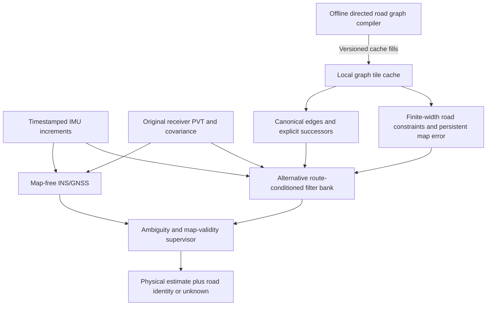

# Navigation research

Research on **tiled-road-aided, loosely coupled INS/GNSS navigation** for low-bandwidth devices. The initial experiment uses a bounded bank of alternative road-conditioned filters, finite-width road corridors, persistent error states, and an independent map-free fallback.

This repository contains a **planar Python research prototype and synthetic evidence**, not field-qualified u-blox M9 / LSM6DSO firmware. Road association and physical coordinate correction are deliberately separate questions. See the [validation report](routefusion_prototype/docs/VALIDATION.md), including the cases where map feedback makes positioning worse.

## Start here

| Resource | Contents |
|---|---|
| [Research and design](routefusion_prototype/docs/DESIGN.md) | Literature synthesis, probabilistic model, uncertainty, architecture, and tradeoffs |
| [Integration guide](routefusion_prototype/docs/INTEGRATION.md) | Existing ESKF adapter, timestamps, frames, covariance, and map-tile contract |
| [Validation and limitations](routefusion_prototype/docs/VALIDATION.md) | 24 tests, six scenarios, 60 runs, positive and negative results |
| [Executable code](routefusion_prototype/routefusion) | Navigation filter, road hypothesis bank, tile compiler, replay, and simulator |
| [Source ledger](routefusion_prototype/sources.json) | 15 primary references, original URLs, and inspection limits |
| [Frozen evidence](routefusion_prototype/results) | Metrics, 60 CSV traces, six input-log/tile examples, replay output, and plot |
| [Combined report](routefusion_research_and_design.md) | Original standalone research, validation, and integration report |
| [Portable bundle](artifacts/routefusion_prototype.zip) | Repacked original project snapshot; contents checked against original hashes |
| [Provenance](docs/PROVENANCE.md) | Original versus rerun evidence, checksums, and scope |

## Architecture



Branch outputs are alternatives, not independent sensors to fuse back into one another. The raw per-satellite GNSS interface and a continuous correction stream are not prerequisites for this prototype.

## Run locally

From the repository root, using Python 3.13 for the captured dependency versions:

```sh
python -m venv .venv
. .venv/bin/activate
python -m pip install -r routefusion_prototype/requirements-tested.txt \
  matplotlib==3.10.8 Pillow==12.3.0 -e ./routefusion_prototype
python -m pytest -q routefusion_prototype/tests
python scripts/verify_snapshot.py
python scripts/reproduce.py --output runs/my-evaluation
```

On Windows PowerShell, activate with `.venv\Scripts\Activate.ps1`. The reproduction helper sets the BLAS environment itself, refuses to overwrite an existing run, compares non-timing metrics with the frozen results, checks replay, and writes fresh logs and plots to the selected `runs/` directory.

The original project README is preserved byte-for-byte as historical provenance. Prefer the safe repository-root commands above over its old command that overwrites `results/`.

## Evidence boundary

The original evaluation used seeds 100–109, six scenarios, 120 seconds per run, and 7,200 map epochs. It is not a hardware trial, an UrbanNav evaluation, or a benchmark of an existing production navigation filter.

A shifted map increased position RMSE despite correct road identification; symmetric parallel roads remained unresolved; off-road rejection took three seconds in the synthetic case. Conditional branch weights are not calibrated integrity probabilities. All of these limits remain part of the research record.

Keep future experiments and hardware recordings separate from this initial snapshot. No third-party papers, commercial map extracts, or private device recordings are redistributed here, and no new project license is assigned by this import.
